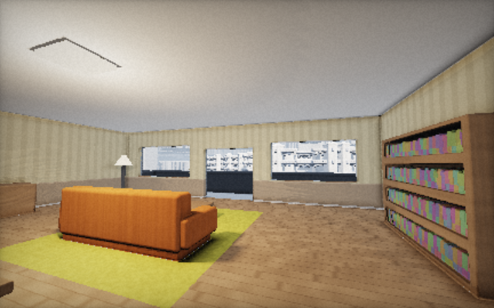
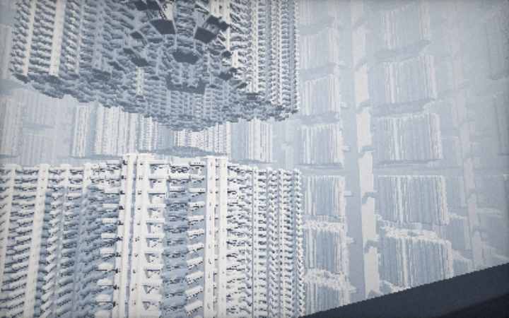
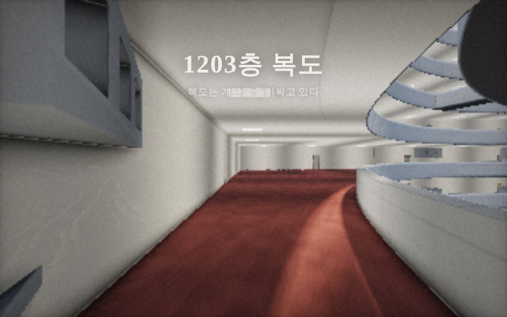
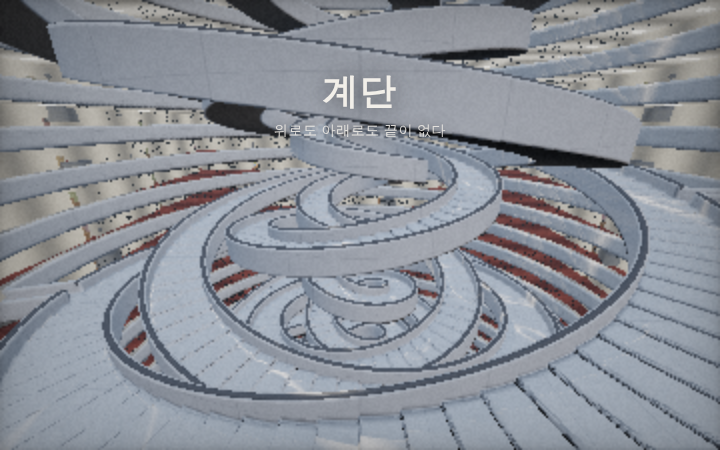
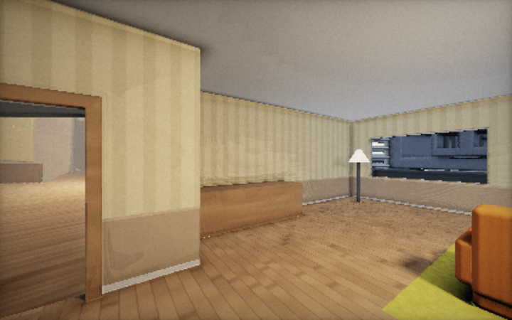
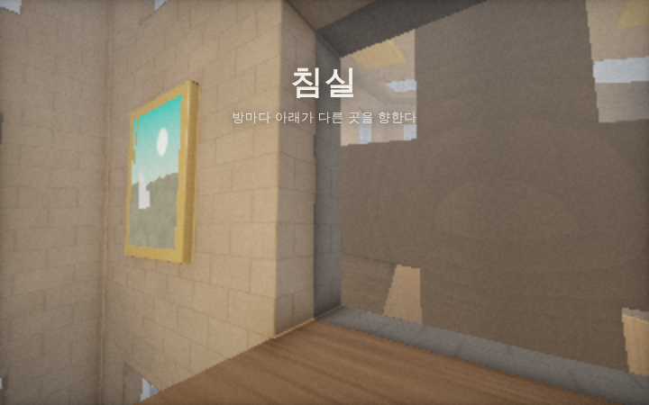

# 평범한 집 · An Ordinary Home

평범한 아파트인 줄 알았던 우리 집이, 끝없이 증식하는 거대한 탑의 한 칸이었다는 것을 걸어서 알아가는 **1인칭 웹 3D 건축 체험**.
메시도, 텍스처도, 라이브러리도 없이 **WebGL2 프래그먼트 셰이더(레이마칭 + 부호 거리 함수)** 만으로 모든 집, 계단, 탑을 픽셀마다 실시간 계산합니다.
충돌 판정도 화면에 그리는 것과 **같은 거리 함수를 GPU에서 직접 읽어서** 계산하므로, 보이는 것이 곧 부딪히는 것입니다.

▶ **실행:** `index.html`을 브라우저로 열면 됩니다(빌드 과정 없음). Vercel·GitHub Pages 같은 정적 호스팅에 그대로 올라갑니다.

| 1203층 3호, 우리 집 | 발코니 밖 |
|---|---|
|  |  |
| **복도와 계단 아트리움** | **끝없는 계단** |
|  |  |
| **침실 문** | **뒤틀린 방** |
|  |  |

## 무엇이 있나

- **집 (외부보다 거대한 내부):** 거실, 부엌, 책장, 발코니, 침실 문이 있는 평범한 아파트입니다. 한 층에 이런 집이 20채 있고, 층은 위로도 아래로도 끝없이 이어집니다. **모든 집에 실제로 들어갈 수 있습니다.** 집마다 벽지 색과 불 켜짐이 다릅니다.
- **끝없는 계단:** 현관을 나서면 복도가 나오고, 복도는 탑 한가운데의 아트리움을 둘러쌉니다. 아트리움에서는 네 겹의 나선 계단이 서로 반대로 돌며 위아래로 끝없이 이어집니다. 층마다 계단으로 건너가는 다리가 있어서 걸어서 다른 층으로 갈 수 있습니다.
- **재귀적으로 증식하는 타워:** 탑에서 뻗은 다리 끝에 절반 크기의 같은 아파트 탑이 있고, 그 탑도 다시 증식합니다. 멀리 보이는 창문 하나하나가 모두 누군가의 집입니다.
- **공간이 뒤틀린 연결:** 어느 집이든 침실 문을 열면 방들이 격자로 무한히 이어진 공간이 나옵니다.
  - 방마다 중력 방향이 달라서, 문을 넘어가면 몸이 돌아갑니다.
  - 멀어질수록 공간이 비틀립니다.
  - 들어온 문으로 돌아가면 원래 집으로 나옵니다.
  - 창문으로 뛰어들면 탑 바깥 허공으로 떨어지다가 어느 집 발코니에 착지합니다.

## 조작

| 입력 | 동작 |
|---|---|
| `W` `A` `S` `D` / 방향키 | 걷기 (`Shift` 달리기) |
| 마우스 (클릭하면 마우스 잠금) | 둘러보기 |
| `Space` | 점프 |
| `Space` 두 번 | 비행 ↔ 다시 중력 받기 |
| 비행 중 `Space` / `C` | 상승 / 하강 |
| `R` | 우리 집으로 |
| `1`–`5` | 빠른 이동 (집 · 복도 · 계단 다리 · 발코니 · 뒤틀린 방) |
| `N` | 유령 모드 (벽 통과) |
| `H` | UI 숨기기 · `[` `]` 최대 해상도 |
| 터치 | 왼쪽 드래그 이동, 오른쪽 드래그 시점, 오른쪽 탭 점프(두 번: 비행) |

URL 끝에 `#corridor`, `#stairs`, `#balcony`, `#rooms`를 붙이면 해당 위치에서 시작합니다. 해상도는 프레임레이트에 맞춰 자동 조절되며, `?scale=1`을 붙이면 고정됩니다.

## 구조

```
index.html               UI
js/main.js               WebGL2, 1인칭 물리(중력/점프/비행/방별 중력), GPU 거리장 충돌 프로브, 포털 이동, HUD
js/shaders/common.js     공용 GLSL: 노이즈, SDF 유틸, AO/그림자, 포털을 통과하는 레이마칭 루프, 충돌 프로브 셰이더
js/shaders/world.js      두 공간(탑 / 뒤틀린 방)과 그 사이의 포털 규칙
js/shaders/sceneTower.js 아파트 탑: 집, 복도, 계단 아트리움, 발코니, 재귀 타워
js/shaders/sceneD.js     뒤틀린 방 격자 (방마다 회전된 중력, 도메인 워프)
```

포털은 축 정렬 평면 위의 사각형과 아핀 변환 `p' = R(p − A)·k + B`로 정의됩니다. 광선과 플레이어가 같은 규칙으로 공간을 넘어가므로, 문 너머가 끊김 없이 보입니다. 방별 중력은 셰이더와 JS가 비트 단위로 같은 정수 해시를 써서, 보이는 방향과 실제 중력이 일치합니다.

WebGL2와 `EXT_color_buffer_float`(충돌 프로브용)를 지원하는 브라우저를 권장합니다. 지원하지 않으면 유령 모드로 동작합니다.
