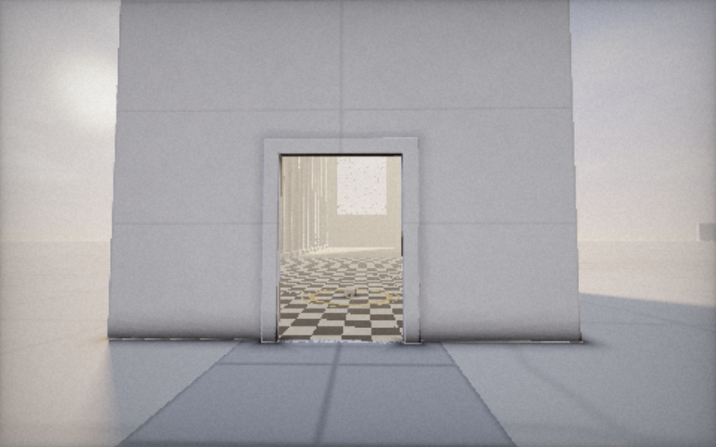
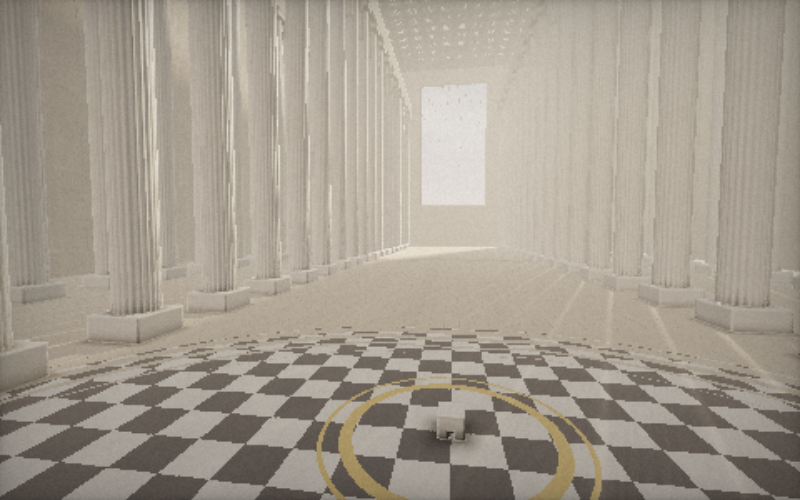
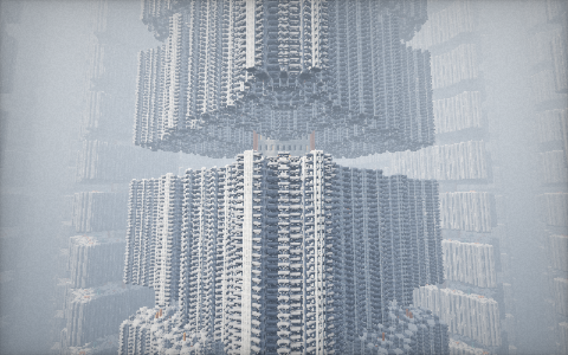
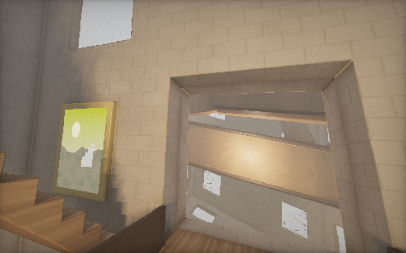

# 불가능한 건축 · Impossible Architecture

하나의 거대한 건축물이 끝없이 증식하고, 내부와 외부의 공간 법칙이 뒤틀리는 **웹 기반 3D 건축 시뮬레이션**.
메시·텍스처·라이브러리 없이 **WebGL2 프래그먼트 셰이더(레이마칭 + 부호 거리 함수)** 만으로 모든 계단과 기둥과 방을 픽셀마다 실시간 계산합니다.

▶ **실행:** `index.html`을 브라우저로 열거나, GitHub Pages(https://hjg1473.github.io/Extremely-Weird-Building/)에서 바로 실행. 빌드 과정 없음.
URL 뒤에 `#A` ~ `#D`를 붙이면 해당 공간으로 바로 들어갑니다.

| B. 외부보다 거대한 내부 — 문 너머 | B. 내부의 대전당 |
|---|---|
|  |  |
| **C. 재귀적으로 증식하는 타워** | **D. 공간이 뒤틀린 연결 구조** |
|  |  |

## 네 개의 공간

**A. 끝없이 이어지는 계단** — 반지름이 다른 네 겹의 나선 계단이 서로 반대 방향으로 천천히 회전하며 위아래로 무한히 이어집니다. 20각형 벽의 창 너머로는 같은 계단실이 격자로 무한 반복되고, 그 사이를 거대 구조물의 슬래브가 채웁니다. 나선은 극좌표에서 각도를 계단 수로 양자화해 만든 SDF이고, 높이 방향은 피치의 최소공배수로 감싸서 카메라가 영원히 내려가도 정밀도가 깨지지 않습니다.

**B. 외부보다 거대한 내부** — 소금 평원 위의 6m 정육면체. 문을 지나는 순간 광선과 카메라가 **30배 스케일의 다른 좌표계**로 넘어갑니다. 안에는 기둥 회랑과 아치, 격자 천장이 있는 1km 길이의 대전당이 있고, 그 바닥 한가운데 같은 정육면체가 또 놓여 있습니다. 그 안에도, 그 안에도… 레이마처가 문 평면을 통과하는 선분을 검사해 좌표계를 바꾸기 때문에, 바깥에서 문을 들여다보면 정육면체 뒷벽보다 훨씬 먼 곳까지 내부가 이어져 보입니다. 안에서 돌아보면 거대한 문 너머로 바깥 세계가 보입니다. 우측 상단에 현재 깊이와 축척(1:30ⁿ)이 표시됩니다. `TOUR`를 켜면 끝없이 안으로 들어갑니다.

**C. 재귀적으로 증식하는 타워** — 무한히 솟은 중심 코어가 48m마다 다리를 뻗어 절반 크기의 탑 네 개를 낳고, 각 탑이 다시 네 개를 낳기를 다섯 세대 반복합니다(KIFS 폴딩). 이 군락이 수평으로 무한 반복되며, 다리 길이와 자식 탑의 방향이 시간에 따라 숨 쉬듯 변합니다. 창문 일부에는 불이 켜져 있습니다.

**D. 공간이 뒤틀린 연결 구조** — 24m 방이 3차원 격자로 무한히 이어지고, 방마다 정육면체 대칭군 중 하나로 회전·반전되어 **중력의 방향이 제각각**입니다. 모든 벽 중앙에 문이 있어 서로 연결되고, 계단·다리·중2층이 엉뚱한 방향을 향합니다. 창밖에는 그 방만의 하늘이, 액자에는 저마다 다른 풍경이 있습니다. 카메라 주위로 공간이 비틀려(트위스트 + 벤드 도메인 워프) 멀리 있는 방일수록 휘어집니다. 좌측 하단 슬라이더로 뒤틀림 강도를 조절할 수 있습니다.

## 조작

| 입력 | 동작 |
|---|---|
| `W` `A` `S` `D` / 방향키 | 이동 |
| `E` / `Space`, `Q` / `C` | 상승 / 하강 |
| 드래그, 또는 더블클릭(마우스 잠금) | 시점 회전 |
| `Shift` | 5배 가속 |
| 마우스 휠 | 이동 속도 조절 |
| `Z` / `X` | 카메라 기울이기 (롤) |
| `1`–`4` | 공간 A–D 전환 |
| `T` | 자동 비행 투어 |
| `R` | 시작 위치로 |
| `H` | UI 숨기기 |
| `[` `]` | 최대 해상도 조절 |
| 터치 | 왼쪽 절반 드래그 = 이동, 오른쪽 절반 드래그 = 시점 |

해상도는 프레임레이트에 맞춰 자동으로 조정됩니다(목표 ~50fps). 고정 해상도로 보려면 `?scale=1`을 붙이세요.

## 구조

```
index.html            UI, 레이아웃
js/main.js            WebGL2 셋업, 카메라/입력, 포털 좌표 변환(B), 적응형 해상도, 투어
js/shaders/common.js  공용 GLSL: 노이즈, SDF 유틸, 하늘, AO/소프트섀도, 레이마칭 메인 루프(포털·구간별 안개 지원)
js/shaders/sceneA.js  나선 계단 SDF
js/shaders/sceneB.js  정육면체 / 대전당 SDF + 포털 함수
js/shaders/sceneC.js  재귀 타워 SDF
js/shaders/sceneD.js  회전된 방 격자 + 도메인 워프
```

각 장면은 별도의 셰이더 프로그램으로 컴파일되며(`KHR_parallel_shader_compile` 사용 가능 시 백그라운드 컴파일), 공용 메인 루프에 `map / shade / sky / fog` 함수를 끼워 넣는 구조입니다. WebGL2를 지원하는 데스크톱 브라우저와 외장/내장 GPU를 권장합니다.
