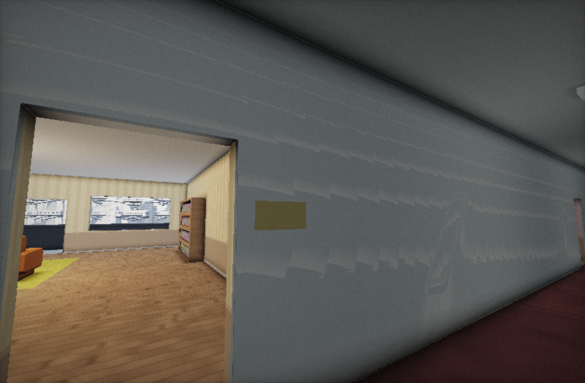
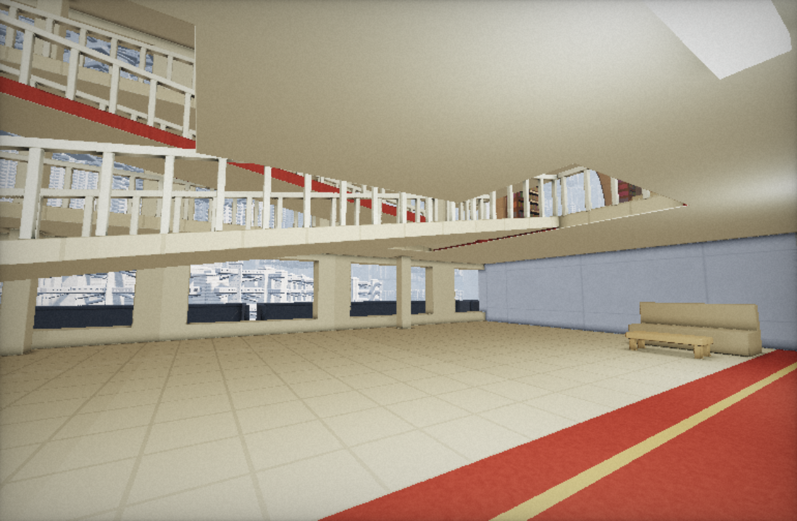
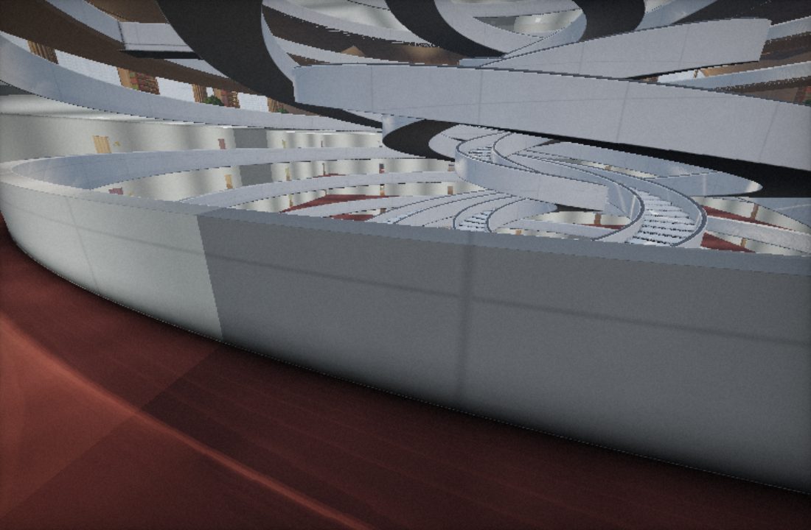
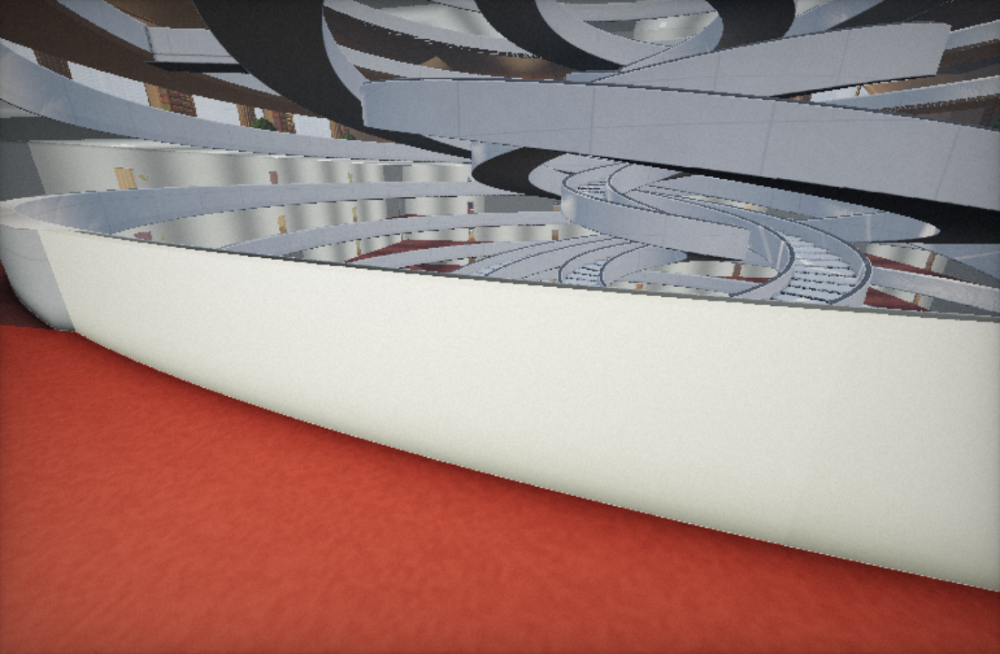
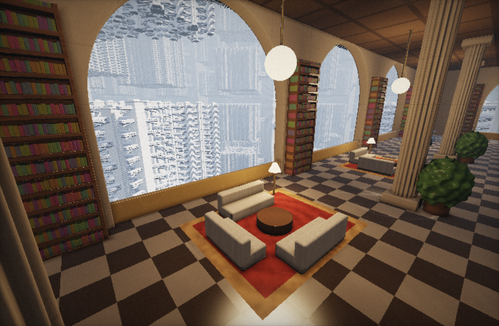
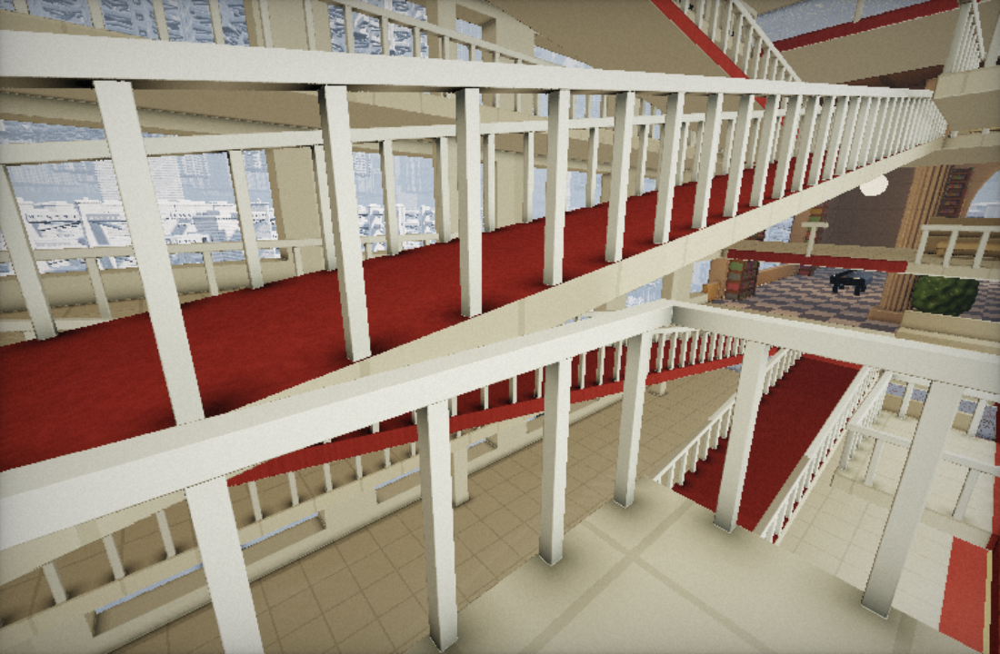
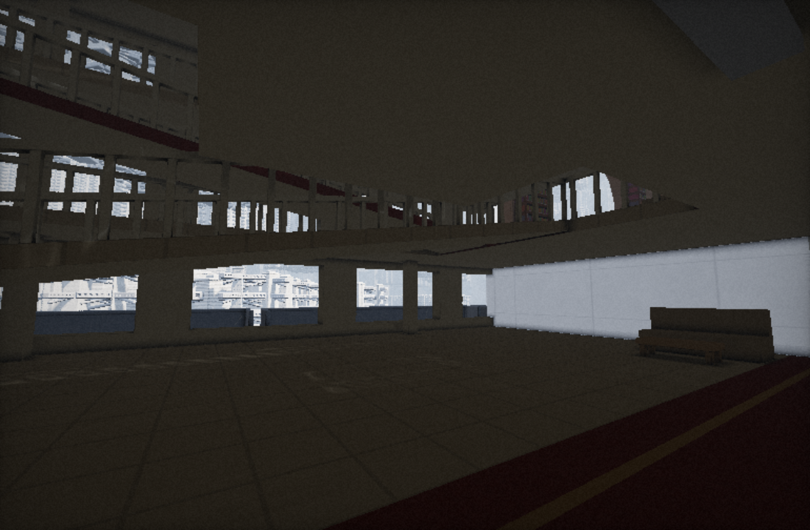

# 동쪽 갤러리: 공간 생성 리팩터링

## 기존 규칙 분석

- `sceneTower.js/mapFloors`: 3.6m 층고, 폭 12m 아파트 20개. 외벽까지의 솔리드 띠에서 직육면체 실내를 빼는 방식이라 현관 외에는 복도와 시야가 끊겼다.
- 현관은 폭 1.2m, 높이 2.2m. 발코니 출입구는 폭 2.4m. 각 아파트 침실에도 폭 1.2m 포털이 있었으며, JS 이동과 GLSL 광선 이동이 각각 이를 처리했다.
- `mapAtrium`: 반경 26.5m 중앙 공동, 네 겹의 나선 계단, 층별 각도가 72도씩 달라지는 연결 다리. 공동은 이미 존재했지만 아파트의 벽과 매 층의 바닥판이 주변 프로그램과 분리했다.
- 라운지는 12층마다 3개 층을 공유한다. 기존 가구·아치·중앙 계단·다른 방향의 아파트는 그대로 재사용한다.

## 변경한 구역과 생성 순서

동쪽 1203–1208층만 `gallery.js`의 bounded SDF로 재설계했다. 기존 월드를 삭제하거나 별도 메시 엔진으로 전환하지 않았다.

1. 기존 중앙 공동을 보존하고, 동쪽에 6개 층을 관통하는 두 번째 공동을 확보한다.
2. 공동 가장자리의 안쪽·바깥쪽 갤러리와 양 끝의 넓은 랜딩을 만든다.
3. 서로 다른 두 통로를 쓰는 폭 2.2m, 길이 24m, 경사 15%의 왕복 경사로를 붙인다. 총 5개 경사로가 6개 층을 연결하며, 반대 방향 경사로가 머리 위에 교차하지 않는다.
4. 중간 층마다 위치가 바뀌는 돌출 전망 발코니를 붙인다. 여기서 경사로, 다른 층의 복도, 옆 라운지를 함께 볼 수 있다.
5. 개방형 휴게 공간에 소파·테이블을 배치하고 크림색 외벽, 베이지 타일, 붉은 카펫, 밝은 목재, 흰 난간과 형광등을 적용한다.

기존 나선 계단 다리의 각도에 맞춰 난간 출입구도 보존했다. 갤러리에서 제거된 침실의 포털은 카메라와 광선 양쪽에서 비활성화했다. 구역 밖의 좁은 복도·밀폐형 침실·중력 공간은 대비를 위해 유지한다.

기본 시작점과 `7`은 동쪽 갤러리. `1` / `R`은 갤러리 옆에 보존한 집, `6`은 서쪽의 기존 라운지. `#gallery`, `#home`, `#lounge`로 직접 시작할 수 있다.

이번 단계의 불가능한 규모는 기존 무한 수직 반복과 재귀 타워를 활용한다. 경사로를 한 바퀴 돌면 출발 층으로 되돌아오는 새 포털 루프는 이번 변경에 포함하지 않았다.

## 형광등과 전원

기존에는 큰 층 번호를 float 사인 해시에 넣었고, 대부분의 등은 극히 드물게만 어두워졌다. 건물 이벤트도 0.25–0.85초의 전압 저하였으며 등마다 일부만 어두워져 완전 정전이 아니었다. 시간까지 물리 timestep의 최대 50ms로 제한되어 낮은 FPS에서는 이벤트가 더 늦어졌다.

- GLSL 정수 해시로 등별 상태를 고정: 약 10% 고장, 30% 불규칙 깜빡임, 60% 정상 점등. 비율은 전체 분포이며 작은 구역에서는 달라진다.
- 깜빡이는 등은 정상 점등 구간과 무작위 점멸 구간을 오간다. 발광체와 주변 조명이 같은 값을 쓴다.
- 전원은 오디오 권한과 독립적으로 실제 활성 탭 시간을 따른다. 첫 정전은 셰이더 준비 후 25–50초, 이후는 복구 후 45–115초 사이.
- 4–9초 동안 모든 전기 조명이 꺼지고 3.5초에 걸쳐 등마다 순차적으로 복구된다. 고장 난 등은 복구되지 않는다. 바깥 자연광은 남는다.
- 기존 짧은 전압 저하와 목소리 이벤트는 유지하고, 형광등 소리도 전원 공급량을 따른다.

## 검증 및 재현

`node --test tools/power.test.cjs`

Playwright를 사용할 수 있는 환경에서 `node tools/browser-check.cjs after`를 실행한다. 기본 브라우저는 설치된 Microsoft Edge이며 `BROWSER_CHANNEL`로 변경할 수 있다. Playwright 패키지가 전역 제공되는 환경은 `PLAYWRIGHT_MODULE`에 모듈 경로를 지정한다. 별도 빌드나 런타임 의존성을 게임에 추가하지 않았다.

브라우저 검증은 실제 WebGL2 셰이더 컴파일, GPU 거리장 바닥/통로/머리 공간 검사, 기존 카메라의 실제 걷기·경사로 오르기, 침실 포털 보존, 전원 복구 및 GPU 형광등 출력 검사를 수행한다. 원본과 같은 좌표·시선·해상도에서 스크린샷을 저장한다.

2026-10-12 Microsoft Edge headless 실측: 공간·이동·전원 검사 11개 통과, 전원 단위 테스트 3개 통과. GLSL 형광등 80개를 시간별로 읽어 고장 9개, 정상 49개, 깜빡임 22개를 확인했고 정전 시 80개 모두 출력 0, 복구 후 원래 상태 복귀를 확인했다. 기기별 프레임레이트와 모바일 터치 조작은 이번 검증 범위에 포함하지 않았다.

| 위치 | 변경 전 | 변경 후 |
|---|---|---|
| 동쪽 입구 |  |  |
| 중앙 공동 방향 |  |  |
| 상층 전망점 |  |  |

정전: 
